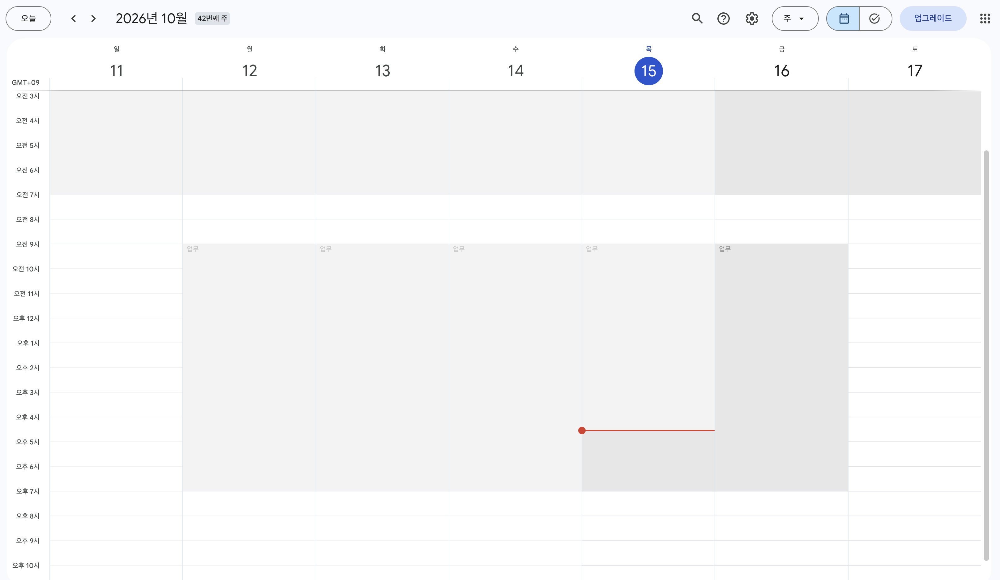
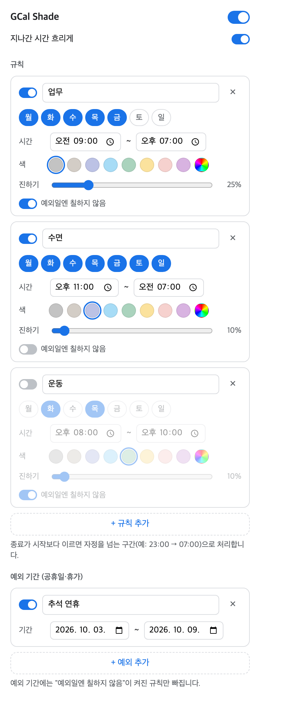

# GCal Shade

구글 캘린더 주/일 보기에서 요일·시간대 규칙에 따라 배경색을 칠하는 크롬 확장 프로그램.

## 기능
- 요일·시간대별 배경색 규칙 (자정을 넘는 구간 지원, 예: 23:00 → 07:00)
- 구간 이름 표시, 색상 프리셋
- 지나간 시간 흐리게
- 예외 기간 (공휴일·휴가) — 규칙별로 적용 여부 선택
- 전체 / 규칙별 / 예외별 켜기·끄기

## 설치
1. `chrome://extensions` → 우측 상단 **개발자 모드** 켜기
2. **압축해제된 확장 프로그램을 로드합니다** → 이 폴더 선택
3. 툴바의 확장 아이콘을 눌러 규칙 편집

## 동작 방식
- `[role="gridcell"][data-datekey]` 컬럼을 찾아 맨 아래 레이어로 색 밴드를 넣는다 (일정 칩보다 아래, 클릭 통과).
- `data-datekey` = `((year-1970)<<9) | (month<<5) | day`
- 구글 캘린더 DOM이 바뀌면 `content.js`의 `findDayColumns()`만 고치면 된다.
